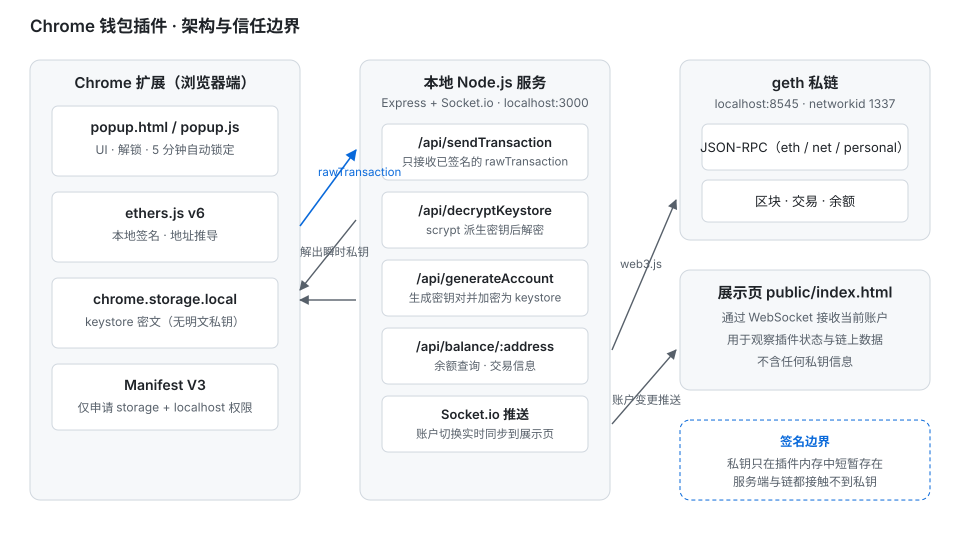

# Chrome Plug Wallet

基于以太坊私链的 Chrome 钱包插件，实现 MetaMask 的核心链路：keystore 加密存储、多账户管理、本地签名与广播，配套一个本地 Node.js 服务负责链上交互与 keystore 解密。

做这个项目的出发点很直接：MetaMask 这类钱包对大多数开发者是黑盒——助记词怎么推导地址、私钥存在哪、点「确认」之后到底发生了什么，都看不见。所以自己从零实现一遍，把「密钥管理」和「签名边界」这两件事彻底搞清楚。

## 架构与信任边界



整体拆成三层，并且**刻意让私钥只在最左边一层出现**：

| 层 | 职责 | 能否接触私钥 |
| --- | --- | --- |
| Chrome 扩展（`plug/`） | UI、解锁、keystore 存储、交易签名 | 仅解锁后在内存中短暂存在 |
| 本地 Node 服务（`server/`） | 生成账户、解密 geth keystore、广播交易、查询链上数据 | 否（只接收已签名交易） |
| geth 私链 | 打包交易、维护状态 | 否 |

## 核心设计

### 1. 私钥不出插件

发送交易时，插件用 `ethers.js` 在本地完成签名，只把 `rawTransaction` 通过 HTTP 交给服务端，服务端再用 `web3.eth.sendSignedTransaction` 广播。**服务端从头到尾拿不到私钥，也拿不到助记词**，即使服务端代码被完全读取，也无法伪造用户交易。

### 2. keystore 加密存储，而非明文私钥

账户以 keystore（scrypt 派生密钥 + AES-128-CTR 加密）形式存放在 `chrome.storage.local`，明文私钥不落盘。查看私钥、发送交易都需要重新输入密码解密。

### 3. 为什么 keystore 解密放在服务端

geth 导出的 keystore 用 scrypt 做密钥派生，而 Chrome 扩展的 Web Crypto API **不提供 scrypt**；用纯 JS 实现 scrypt 在插件里既慢又要额外引入体积不小的依赖。所以把解密放到本地 Node 服务，复用 Node 内置 `crypto.scrypt`，插件只接收解密结果并立即使用。

这是一个有意识的取舍：解密过程依赖本地服务可用，换来的是不引入第三方加密库、行为与 geth 完全一致。

### 4. 自动锁定

5 分钟无操作自动锁定并清空内存中的解密状态，界面显示倒计时。锁定后所有敏感操作都需要重新输密码。

## 功能

- **创建钱包**：设置密码初始化，密码不明文存储，仅用于解密校验
- **生成账户**：服务端生成密钥对，`ethers.js` 加密为 keystore 写入 Chrome Storage
- **导入私钥**：支持粘贴 `0x` 开头的私钥
- **导入 Keystore 文件**：兼容 geth 生成的 `UTC--` 格式
- **查询余额**：连接本地私链实时查询
- **发送交易**：插件端签名，服务端只广播已签名交易
- **查看私钥**：需重新输入密码解密后才显示
- **账户切换**：选中账户通过 Socket.io 实时同步到展示页
- **自动锁定**：5 分钟无操作锁定，带倒计时

## 快速开始

### 环境要求

- Node.js >= 16
- Chrome 浏览器
- geth（本地私链监听 `8545`）

### 1. 启动 geth 私链

```bash
geth --datadir ./data --networkid 1337 --http --http.port 8545 \
     --http.corsdomain "*" --http.api eth,net,web3,personal \
     --allow-insecure-unlock console
```

### 2. 启动本地服务

```bash
cd server
npm install
node server.js
```

访问 http://localhost:3000 可查看当前选中账户（展示页）。

### 3. 加载插件

1. 打开 `chrome://extensions/`
2. 开启右上角「开发者模式」
3. 点击「加载已解压的扩展程序」，选择 `plug/` 目录
4. 点击工具栏插件图标开始使用

## 接口

| 方法 | 路径 | 说明 |
| --- | --- | --- |
| POST | `/api/generateAccount` | 生成密钥对并返回加密后的 keystore |
| POST | `/api/decryptKeystore` | 用 scrypt 解密 keystore（兼容 geth 格式） |
| POST | `/api/sendTransaction` | 广播已签名的 `rawTransaction` |
| GET | `/api/balance/:address` | 查询地址余额 |
| POST | `/api/account` | 同步当前选中账户并推送 |
| POST | `/api/txInfo` | 查询交易详情 |

## 目录结构

```
.
├── plug/                      # Chrome 扩展（Manifest V3）
│   ├── manifest.json          # 权限：storage + localhost:3000
│   ├── popup.html / popup.js  # 弹窗 UI 与全部钱包逻辑
│   ├── ethers.min.js          # ethers.js v6（本地引入，便于离线加载）
│   └── images/                # 图标
├── server/
│   ├── server.js              # Express + Socket.io，链上交互与 keystore 解密
│   ├── demo01_mnemonic.js     # 演示：BIP39 助记词与 BIP44 多账户推导
│   ├── demo02_signature.js    # 演示：ECDSA 签名与 ecrecover 验签
│   └── public/index.html      # 展示页（WebSocket 接收当前账户）
└── docs/architecture.svg      # 架构图
```

## 演示脚本

两个独立脚本用于理解底层机制，在 `server/` 目录下运行：

```bash
# BIP39 助记词生成、BIP44 路径推导多账户、可重复性验证
node demo01_mnemonic.js

# ECDSA 消息签名与 ecrecover 还原签名者地址
node demo02_signature.js
```

`demo02_signature.js` 使用 ES Module 语法，需保证 `server/package.json` 含 `"type": "module"`。

## 技术栈

| 模块 | 技术 |
| --- | --- |
| 插件 | Manifest V3、Chrome Storage API、原生 JS |
| 前端加密与签名 | ethers.js v6 |
| 本地服务 | Node.js、Express、Socket.io |
| 链交互 | web3.js v4、geth 私链 |
| keystore 解密 | Node 内置 crypto（scrypt + AES-128-CTR） |

## 已知限制

- 仅支持单条本地私链（`networkid 1337`），未实现网络切换与主网适配
- 解密结果经由 `http://localhost:3000` 回传插件，属于本机信任模型；生产级钱包应改为在扩展内完成派生，或经独立进程以 IPC / 原生消息通信，避免私钥经过 HTTP
- 未实现硬件钱包、交易详情预览、Gas 自定义、多标签会话隔离
- 展示页为单用户本地页面，无鉴权，不应暴露到公网
- 未做单元测试，验证方式为手工回归（创建 / 导入 / 查询 / 签名 / 广播 / 锁定）

## 说明

本项目仅用于学习与实验，连接本地私链，请勿在主网使用。
